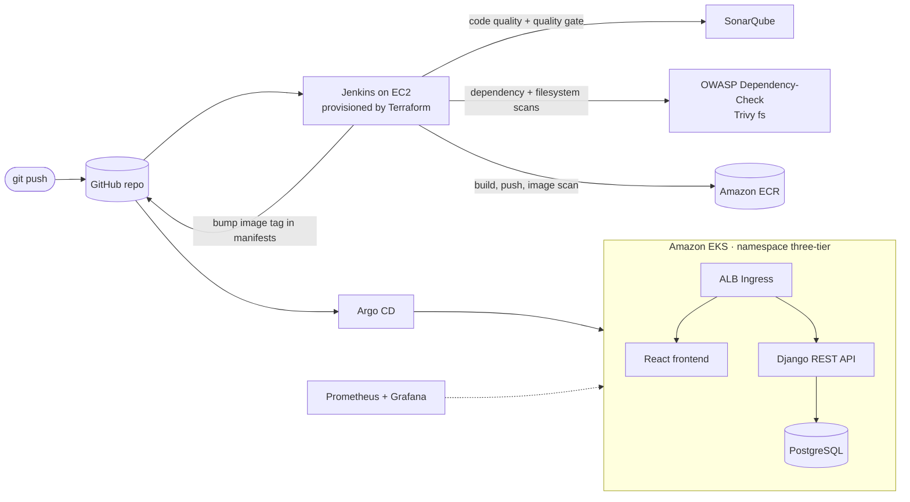

<<<<<<< HEAD
# Three-Tier DevSecOps Project on AWS EKS

Deploy a React + Django + PostgreSQL application to **Amazon EKS** with a security-first CI/CD pipeline:
**Jenkins** builds and scans every change (SonarQube, OWASP Dependency-Check, Trivy), pushes images to **Amazon ECR**,
and **Argo CD** deploys them GitOps-style. **Prometheus** and **Grafana** watch the cluster.
The Jenkins server itself is provisioned with **Terraform**.

[](https://youtube.com/@codewithmuh)
[](https://www.linkedin.com/in/muhammadrashid-daha/)
[](https://medium.com/@codewithmuh)
[](https://github.com/codewithmuh/three-tier-devsecops-project/actions/workflows/secret-scan.yml)
[](LICENSE)

📺 **Video walkthrough:** https://youtu.be/UNF5JdUEfh8 &nbsp;·&nbsp; 📝 **Article:** [Deploying a three-tier DevSecOps web application on AWS EKS](https://www.linkedin.com/pulse/deploying-three-tier-devsecops-web-application-aws-eks-rashid-x7f9f/)


---

## Architecture



**The flow:** every push runs a Jenkins pipeline per tier. If the image passes the scans, Jenkins pushes it to ECR
tagged with the build number, then commits the new tag to `kubernetes-manifests/`. Argo CD notices the commit and rolls
the change out to EKS. No `kubectl apply` from laptops — Git is the source of truth.

## Tech stack

| Layer | Tools |
|---|---|
| Application | React 18 (frontend), Django 5 + Django REST Framework (backend), PostgreSQL |
| Infrastructure as Code | Terraform (Jenkins server: VPC, subnet, security group, EC2, IAM role; S3 + DynamoDB remote state) |
| CI | Jenkins, SonarQube, OWASP Dependency-Check, Trivy, Docker |
| Registry | Amazon ECR |
| CD / GitOps | Argo CD |
| Runtime | Amazon EKS, AWS Load Balancer Controller (ALB Ingress) |
| Monitoring | Prometheus, Grafana |
| Repo security | gitleaks secret scanning on every push and pull request |

## Repository layout

```
app-code/
  backend/                  Django REST API (notes app) + Dockerfile
  frontend/notes-frontend/  React app + Dockerfile
jenkins-pipeline/
  jenkinsfile-backend       CI/CD pipeline for the API
  jenkinsfile-frontend      CI/CD pipeline for the web app
jenkins-server-terraform/   Terraform for the Jenkins server + tools-install.sh (Jenkins, Docker, SonarQube, AWS CLI, kubectl, …)
kubernetes-manifests/
  database/                 PostgreSQL Deployment, Service, PV/PVC, Secret (example only)
  backend/  frontend/       Deployments + Services
  backend-ingress/ frontend-ingress/   ALB Ingress rules
.github/workflows/secret-scan.yml      gitleaks on every push / PR
```

## Pipeline stages

Both `jenkinsfile-backend` and `jenkinsfile-frontend` run the same stages:

1. **Clean workspace** and **checkout** from GitHub
2. **SonarQube analysis** — static code analysis
3. **Quality gate** — waits for SonarQube's verdict
4. **OWASP Dependency-Check** — known-vulnerable libraries
5. **Trivy filesystem scan** — vulnerabilities and misconfigurations in the source tree
6. **Docker build**
7. **Push to Amazon ECR** — tagged with the Jenkins build number
8. **Trivy image scan** — scans the pushed image
9. **Update deployment manifest** — commits the new image tag to `kubernetes-manifests/`, which Argo CD deploys

---

## Prerequisites

- An AWS account and the AWS CLI configured locally
- Terraform ≥ 1.0, `kubectl`, `eksctl` and `helm`
- A domain name for the frontend and API (the ingress files use placeholders you will replace)
- A GitHub personal access token with `repo` scope (Jenkins pushes the image-tag updates)

> ⚠️ **Cost:** the Jenkins server is a `t2.2xlarge`, plus an EKS cluster and an Application Load Balancer.
> This is not free-tier. Follow [Clean up](#clean-up) when you are done.

## Setup

### 1. Provision the Jenkins server with Terraform

Terraform stores its state in S3 with DynamoDB locking, so create those first (names are in
`jenkins-server-terraform/02_backend.tf` — change them to your own):

```bash
aws s3 mb s3://<your-state-bucket> --region us-west-2
aws dynamodb create-table --table-name lock-files --region us-west-2 \
  --attribute-definitions AttributeName=LockID,AttributeType=S \
  --key-schema AttributeName=LockID,KeyType=HASH --billing-mode PAY_PER_REQUEST
```

Create an EC2 key pair in the AWS console (EC2 → Key Pairs) and set its name in `variables.tf` (`key_name`).
**Keep the `.pem` file outside this repository** — `.gitignore` blocks `*.pem`, but don't rely on that alone.

```bash
cd jenkins-server-terraform
terraform init
terraform plan
terraform apply
```

`scripts/tools-install.sh` runs on first boot and installs Jenkins, Docker, SonarQube (as a container on port 9000),
the AWS CLI, kubectl and the other tools the pipeline needs.

### 2. Configure SonarQube

1. Open `http://<jenkins-server-ip>:9000` and change the default admin password.
2. Create a token (**My Account → Security**) — you will store it in Jenkins as `sonar-token`.
3. Add a webhook (**Administration → Configuration → Webhooks**) pointing to `http://<jenkins-server-ip>:8080/sonarqube-webhook/` so the quality gate can report back.

### 3. Configure Jenkins

Open `http://<jenkins-server-ip>:8080` and finish the setup wizard.

**Plugins:** SonarQube Scanner, OWASP Dependency-Check, NodeJS, Eclipse Temurin installer, Docker Pipeline.

**Tools** (*Manage Jenkins → Tools*) — the names must match the Jenkinsfiles:

| Tool | Name |
|---|---|
| JDK 17 | `jdk` |
| NodeJS | `nodejs` |
| SonarQube Scanner | `sonar-scanner` |
| Dependency-Check | `DP-Check` |

**SonarQube server** (*Manage Jenkins → System → SonarQube servers*): name it `sonar-server`, URL `http://<jenkins-server-ip>:9000`,
token credential `sonar-token`. The pipelines get the URL and token from here — **they are never written in the Jenkinsfiles.**

**Credentials** (*Manage Jenkins → Credentials*):

| ID | Kind | Value |
|---|---|---|
| `ACCOUNT_ID` | Secret text | Your AWS account ID |
| `ECR_REPO_BACKEND` | Secret text | Backend ECR repository name (e.g. `backend`) |
| `ECR_REPO_FRONTEND` | Secret text | Frontend ECR repository name (e.g. `frontend`) |
| `GITHUB` | Username with password | GitHub username + personal access token (checkout) |
| `github` | Secret text | GitHub personal access token (pushing manifest updates) |
| `sonar-token` | Secret text | The SonarQube token from step 2 |

Create the two ECR repositories (`aws ecr create-repository --repository-name backend`, and the same for `frontend`),
then create one **Pipeline** job per tier pointing at `jenkins-pipeline/jenkinsfile-backend` and `jenkins-pipeline/jenkinsfile-frontend`.
In both Jenkinsfiles, set `GIT_USER_NAME` / `GIT_REPO_NAME` to your fork.

### 4. Create the EKS cluster and load balancer controller

```bash
eksctl create cluster --name three-tier-cluster --region us-west-2 --node-type t3.medium --nodes 2
```

Install the **AWS Load Balancer Controller** (it turns the Ingress files into an ALB) by following the
[official guide](https://docs.aws.amazon.com/eks/latest/userguide/lbc-helm.html).

### 5. Prepare the namespace and database secret

```bash
kubectl create namespace three-tier
kubectl create secret generic postgres-sec -n three-tier \
  --from-literal=username=<db-user> --from-literal=password=<strong-password>
```

`kubernetes-manifests/database/secrets.yaml` only shows the shape of this secret — don't put real values in Git.

Before deploying, replace the placeholders in the manifests with your own values:
- the ECR image URIs in `backend/deployment.yaml` and `frontend/deployment.yaml` (your account ID and region)
- the hostnames in `frontend-ingress/` and `backend-ingress/` (your domain)

The deployments reference an image-pull secret named `ecr-registry-secret`. Either create it, or remove `imagePullSecrets`
if your worker nodes' IAM role already allows reading from ECR (the default for EKS managed node groups).

### 6. Install Argo CD and deploy

```bash
kubectl create namespace argocd
kubectl apply -n argocd -f https://raw.githubusercontent.com/argoproj/argo-cd/stable/manifests/install.yaml
kubectl -n argocd get secret argocd-initial-admin-secret -o jsonpath="{.data.password}" | base64 -d   # admin password
kubectl -n argocd port-forward svc/argocd-server 8081:443
```

In the Argo CD UI (`https://localhost:8081`), create one Application per folder in `kubernetes-manifests/`
(`database`, `backend`, `frontend`, `backend-ingress`, `frontend-ingress`) with namespace `three-tier` and automatic sync.
Point your domain's DNS records at the ALB that the ingress creates.

### 7. Monitoring with Prometheus and Grafana

```bash
helm repo add prometheus-community https://prometheus-community.github.io/helm-charts
helm repo update
helm install monitoring prometheus-community/kube-prometheus-stack -n monitoring --create-namespace
kubectl -n monitoring port-forward svc/monitoring-grafana 3000:80
```

Grafana's admin password is in the `monitoring-grafana` secret (`admin-password` key). The chart ships with
Kubernetes dashboards for nodes, pods and workloads.

---

## Security practices in this project

- **Secrets stay out of Git.** SonarQube, GitHub and AWS values live in Jenkins credentials; the database password is a
  Kubernetes Secret created from the command line. `.gitignore` blocks keys, `.tfvars` and `.env` files.
- **Secret scanning.** [gitleaks](https://github.com/gitleaks/gitleaks) runs on every push and pull request
  (`.github/workflows/secret-scan.yml`).
- **Shift-left scanning.** SonarQube quality gate, OWASP Dependency-Check and Trivy (source tree and built image) run before anything is deployed.
- **GitOps.** The cluster only changes through commits that Argo CD syncs, so every deployment is reviewable and reversible.
- **Least privilege for Jenkins.** The Jenkins server uses an IAM instance profile instead of long-lived access keys.

For a production setup you would also: run Postgres on Amazon RDS instead of a pod, keep secrets in AWS Secrets Manager
(e.g. via the External Secrets Operator), make Trivy fail the build on HIGH/CRITICAL findings, and add HTTPS to the ALB with ACM.

## Clean up

Delete things in this order so the load balancer and volumes don't linger:

```bash
# 1. Remove the Argo CD applications (this deletes the ALB created by the ingress)
# 2. Delete the cluster
eksctl delete cluster --name three-tier-cluster --region us-west-2
# 3. Destroy the Jenkins server
cd jenkins-server-terraform && terraform destroy
# 4. Delete the ECR repositories, the state bucket and the DynamoDB lock table
aws ecr delete-repository --repository-name backend --force
aws ecr delete-repository --repository-name frontend --force
```

Also delete the EC2 key pair if you created one only for this project.

## Author

**Muhammad Rashid** — DevOps & cloud engineer, AWS Community Builder.
I teach AWS, Kubernetes, DevOps and AI engineering on [YouTube @codewithmuh](https://youtube.com/@codewithmuh).
More at [codewithmuh.com](https://codewithmuh.com) and [devopsbymuh.com](https://devopsbymuh.com).

If this project helped you, a ⭐ on the repo helps others find it.

## License

[MIT](LICENSE)
=======
# cicdTF


## Getting started

To make it easy for you to get started with GitLab, here's a list of recommended next steps.

Already a pro? Just edit this README.md and make it your own. Want to make it easy? [Use the template at the bottom](#editing-this-readme)!

## Add your files

* [Create](https://docs.gitlab.com/user/project/repository/web_editor/#create-a-file) or [upload](https://docs.gitlab.com/user/project/repository/web_editor/#upload-a-file) files
* [Add files using the command line](https://docs.gitlab.com/topics/git/add_files/#add-files-to-a-git-repository) or push an existing Git repository with the following command:

```
cd existing_repo
git remote add origin https://gitlab.com/free-group2874537/cicdtf.git
git branch -M main
git push -uf origin main
```

## Integrate with your tools

* [Set up project integrations](https://gitlab.com/free-group2874537/cicdtf/-/settings/integrations)

## Collaborate with your team

* [Invite team members and collaborators](https://docs.gitlab.com/user/project/members/)
* [Create a new merge request](https://docs.gitlab.com/user/project/merge_requests/creating_merge_requests/)
* [Automatically close issues from merge requests](https://docs.gitlab.com/user/project/issues/managing_issues/#closing-issues-automatically)
* [Enable merge request approvals](https://docs.gitlab.com/user/project/merge_requests/approvals/)
* [Set auto-merge](https://docs.gitlab.com/user/project/merge_requests/auto_merge/)

## Test and Deploy

Use the built-in continuous integration in GitLab.

* [Get started with GitLab CI/CD](https://docs.gitlab.com/ci/quick_start/)
* [Analyze your code for known vulnerabilities with Static Application Security Testing (SAST)](https://docs.gitlab.com/user/application_security/sast/)
* [Deploy to Kubernetes, Amazon EC2, or Amazon ECS using Auto Deploy](https://docs.gitlab.com/topics/autodevops/requirements/)
* [Use pull-based deployments for improved Kubernetes management](https://docs.gitlab.com/user/clusters/agent/)
* [Set up protected environments](https://docs.gitlab.com/ci/environments/protected_environments/)

***

# Editing this README

When you're ready to make this README your own, just edit this file and use the handy template below (or feel free to structure it however you want - this is just a starting point!). Thanks to [makeareadme.com](https://www.makeareadme.com/) for this template.

## Suggestions for a good README

Every project is different, so consider which of these sections apply to yours. The sections used in the template are suggestions for most open source projects. Also keep in mind that while a README can be too long and detailed, too long is better than too short. If you think your README is too long, consider utilizing another form of documentation rather than cutting out information.

## Name
Choose a self-explaining name for your project.

## Description
Let people know what your project can do specifically. Provide context and add a link to any reference visitors might be unfamiliar with. A list of Features or a Background subsection can also be added here. If there are alternatives to your project, this is a good place to list differentiating factors.

## Badges
On some READMEs, you may see small images that convey metadata, such as whether or not all the tests are passing for the project. You can use Shields to add some to your README. Many services also have instructions for adding a badge.

## Visuals
Depending on what you are making, it can be a good idea to include screenshots or even a video (you'll frequently see GIFs rather than actual videos). Tools like ttygif can help, but check out Asciinema for a more sophisticated method.

## Installation
Within a particular ecosystem, there may be a common way of installing things, such as using Yarn, NuGet, or Homebrew. However, consider the possibility that whoever is reading your README is a novice and would like more guidance. Listing specific steps helps remove ambiguity and gets people to using your project as quickly as possible. If it only runs in a specific context like a particular programming language version or operating system or has dependencies that have to be installed manually, also add a Requirements subsection.

## Usage
Use examples liberally, and show the expected output if you can. It's helpful to have inline the smallest example of usage that you can demonstrate, while providing links to more sophisticated examples if they are too long to reasonably include in the README.

## Support
Tell people where they can go to for help. It can be any combination of an issue tracker, a chat room, an email address, etc.

## Roadmap
If you have ideas for releases in the future, it is a good idea to list them in the README.

## Contributing
State if you are open to contributions and what your requirements are for accepting them.

For people who want to make changes to your project, it's helpful to have some documentation on how to get started. Perhaps there is a script that they should run or some environment variables that they need to set. Make these steps explicit. These instructions could also be useful to your future self.

You can also document commands to lint the code or run tests. These steps help to ensure high code quality and reduce the likelihood that the changes inadvertently break something. Having instructions for running tests is especially helpful if it requires external setup, such as starting a Selenium server for testing in a browser.

## Authors and acknowledgment
Show your appreciation to those who have contributed to the project.

## License
For open source projects, say how it is licensed.

## Project status
If you have run out of energy or time for your project, put a note at the top of the README saying that development has slowed down or stopped completely. Someone may choose to fork your project or volunteer to step in as a maintainer or owner, allowing your project to keep going. You can also make an explicit request for maintainers.
>>>>>>> 0849a6a262e4c5645a2e812c2e6ee3f512a782bd
